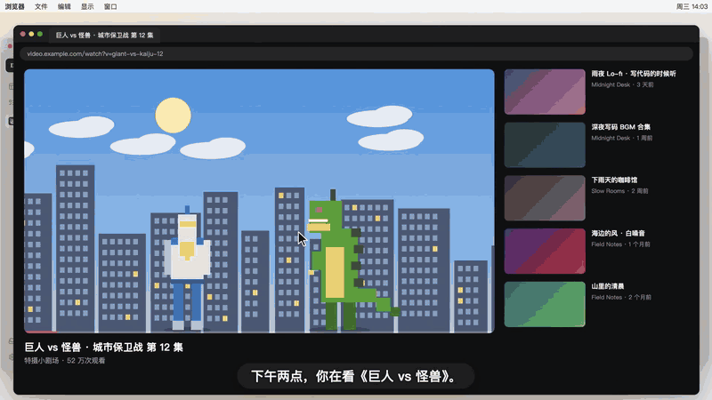

# Superagent（gerdr-panel-superagent）

[Gerdr](https://github.com/gerdr-dev/gerdr) 的一个面板：一个 Code，左边的列表换成一个秘书和按状态分好的任务。

你只跟秘书说话：交代一件事，它挑仓库、派给 Claude Code / Codex 的 worker，替你盯 MR 的 review 意见和流水线，要你拍板时才来问，到点写简报。

*A [Gerdr](https://github.com/gerdr-dev/gerdr) panel: you talk to one secretary, it hands tasks to Claude Code / Codex workers and follows them up. The UI is in Chinese for now.*

- **任务**（主角）：按「待办 / 进行中 / 待验收 / 已完成」分组，每行一个任务，点开就是它 worker 的对话。**你直接跟 worker 说话**：
  它对这件事最熟、上下文最全，问出来的问题也最准；隔着秘书转述会丢上下文，判断就不准。要你拍板的标黄排最前（「等你」）。
  你自己在这里开的对话（新会话页、⌘T、⌘D、分支）也是任务，从一开始就带着面板的工具和规则。
  Code 里原来的对话不显示，要接着做就用列表底下的「从 Code 导入」变成任务。
- **秘书**（列表最上面）：接消息、排任务。外面来的消息（Slack / 飞书私信、@、告警……）先到它这里，它判断接不接、并进哪个任务、
  派给哪个仓库的哪个 agent；你也可以让它记一件事、派一件活，到点它写简报（「定时任务 → 简报」改时间）。
  它不替你盯每个任务，也不替 worker 转述：具体的事在任务里和 worker 谈。它的对话一直接着，长了会压缩；要长期记住的靠任务和「记忆」。
- **Code**：分屏、Tab、终端、浏览器都和 Gerdr 的 Code 一样，只是左边的列表不按工作区分，按每件事走到哪一步分。

它接住你交代的、你在列表里建的任务和外面来的消息（Slack / 飞书私信、@、告警……），判断是不是活、派给哪个仓库的哪个 agent，
结果回到消息来的地方。原则照 [dsh-superagent](https://github.com/deepseek-ai/dsh-superagent-prototype)：尽量少占人的注意力，尽量多给价值。

- 派活：写一句要做什么，选仓库或让它自己挑，派给 Claude Code / Codex 的 worker。
- 任务在哪一组只由你来定：把一行拖到另一组，或在它的菜单里「移到…」；worker 停下、压缩对话、被叫醒都不会挪它。worker 不用汇报，一行底下是它最新的一段话；要你亲手做的步骤、要你拍板的决定在进行中里排最前、标黄（「等你」），点「等你」跳到对话里那张卡片，在对话里直接答。
- 一个任务一个 worker：点开就是它的对话。一件事要拆成几份（前后端、几集视频）就是几张卡，一份等另一份做完再开工；worker 要帮手就开自己的子 agent。
- 外面来的活：设置 →「触发器」选收哪些事件（装了哪些插件就有哪些）、只收谁的。已有任务的对话里的后续直接交给那个任务；
  其余的由秘书判断：接（建任务派出）、并进已有任务、停掉某个任务、不接。每条去了哪，看「去向」。
- MR 有人盯：新的 review 意见、挂掉的流水线作为 MR 上的新消息交给 worker，按你的规则变基、合并。
- 主动工作：不是找你的事（频道闲聊、告警）只按你在「流程 → proactive」里写的规则接；「设置 → 主动工作」默认只记录它本来会怎么做，看对了再放开。
- Let it go：秘书和 worker 什么时候可以不问你。建几套策略，每套是一整套规矩：在哪些时间生效、各环节放不放开（外面来的活直接派还是进待办、
  拿不准和要拍板时自己定还是问你、以你的名义发消息直接发还是先给你过目）、管哪些仓库、哪些人仍要你过目（比如 leader）、worker 的权限模式、说明。
  可以放开很多，也可以什么都不放（下班后一律问你）；没有策略在生效时什么都问你。也能临时换成某一套到某个钟点。没问你就做了的都记下来，换策略时秘书写简报。
- 要你处理的标黄：组名、任务行、秘书那一行上的「等你 N」，点开列出是哪几件，点一件跳到那张卡片。
- 秘书那一行的齿轮：「设置」是代码照着做的值（谁派活、谁干活、仓库列表、MR 合不合、主动工作开不开），默认都是手动的，按需改；
  「流程」是你用自己的话写的做事方式（`skills/superagent-panel/`：怎么交付、review 意见怎么处理、怎么挑仓库），agent 读它。
  「记忆」是每个仓库的具体情况（走不走 MR、谁来合、发布找谁批）：worker 从你说的话里记下来，以后派到这个仓库的 worker 一开始就带着；错了直接改。

**安装**：Gerdr 设置 → 面板 → 从 GitHub 安装面板，填 `https://github.com/gerdr-dev/gerdr-panel-superagent`。
更多面板：GitHub 上带 `gerdr-panel` 标签的仓库，见 https://github.com/topics/gerdr-panel 。

## 开发

在单独的克隆里改（这个仓库），提交、推送；装了它的项目用 `gerdr panel update` 更新，你在 `user/` 里的数据和设置不受影响。
不要在装好的面板目录里直接改代码：那是用的，不是改的。

---

改列表和任务（`ui/src/components/CodeSection.tsx`、`local/tasks.ts` `board.ts` `waits.ts`）之前先读 `DESIGN.md`：为什么这么设计、哪些做法试过被否了。
点开一个任务就是它 worker 的对话，在 Code 的分屏里，没有单独的动态：为什么见 `DESIGN.md` 的「一个任务一个 worker」。
秘书就是秘书会话本身的对话，也在 Code 的分屏里打开，为什么见 `DESIGN.md` 的「秘书」。

这个面板只有一页：Gerdr 的 Code（`ui/src/layout.tsx` 用 `CodeView list="replace"`），左边的列表是 `ui/src/components/CodeSection.tsx` 画的。
最上面「秘书」打开秘书的对话（会话、系统提示词和压缩在 `local/_main.ts`，简报这些调的函数在 `local/secretary.ts`），
你自己开的对话怎么成为任务在 `local/blank.ts`，从 Code 导入在 `local/import.ts`，「去向」看外面来的每条消息去了哪。任务都是派给 agent 的（worker 要用户做的步骤、要他定的事挂在它自己的任务上，不另成任务），按「待办 / 进行中 / 待验收 / 已完成」分组（等你的在进行中里排最前、标黄），
数据在 `user/data/reqs/`（每部分一个文件，`local/_parts.ts`；完成很久的移到 `user/data/archive/`，`local/_archive.ts`），读写都走 `local/_store.ts`。秘书那一行的齿轮是面板设置：「设置」（`ui/src/settings/Settings.tsx`，`user/settings.json`）、「流程」（`ui/src/settings/Flow.tsx`，
编辑 `skills/superagent-panel/`）和「定时任务」（`ui/src/settings/Schedules.tsx`，`schedules/`）。

## 两个 agent：你是哪一个

这个面板里有两个 agent，都会读这份 README：

- **秘书**（会话标题「Superagent 秘书」，系统提示词里说你是用户的秘书）：你这段对话就是秘书（列表最上面的「秘书」打开），用户在那里跟你说话，交代事情、问进度。看下面「秘书怎么做事」。
- **面板助手**（Gerdr 面板右边的对话）：帮用户改这个面板本身。看下面「面板助手做什么」。

## 面板助手做什么

用户找你，是要改这个面板：设置（`settings.get` / `settings.set`）、流程（`skills/superagent-panel/`）、触发器、定时任务（`schedules/`）、
记忆，或者页面和函数的代码（先读 `DESIGN.md`）。怎么加东西，照 Gerdr 给每个面板的 AGENTS.md「Adding to this panel」。

- Let it go：策略在设置里的 `letgo.policies`（`settings.set '{"letgo":{"policies":[…]}}'`，整个列表替换；每套的形状见
  `ui/src/lib/letgo.ts`：times、gates、repos（`"*"` 是所有仓库）、confirm、mode、note）。现在是哪一套：`letgo.status`；
  临时换成一套到某个钟点：`letgo.set '{"policy":"p2","until":"09:00"}'`（`"policy":""` 是不用策略、什么都问，`{"clear":true}` 回到按时间）。
- 流程是用户自己的副本：改一份写进 `user/skills/<同一路径>`（`playbooks.save`），不改仓库里的 `skills/`；
  用户自己的 skill 用 `playbooks.addSkill '{"name":"weekly-report","description":"什么时候读"}'`，
  在已有 skill 里加参考用 `playbooks.addReference`。`playbooks.read` 的 `base` 是改过的文件的默认内容。

- **不派活、不跟进任务**：那是秘书的事，派活、问进度都在秘书那里，两边各说各的会对不上。用户在这里交代了一件要做的事，
  转给秘书（会出现在秘书的对话里），再告诉用户点列表最上面的「秘书」看：`gerdr panel run secretary.say '{"text":"（用户在面板助手那里说的）…"}'`
- 改代码要很久也没关系：你不挡着谁，秘书照常陪用户说话。
- 这份 README 和 `DESIGN.md` 写给改面板的人；面板装好的这份是用的，代码的正式改法见上面「开发」（在开发克隆里改、推送、`gerdr panel update`）。
  用户只想改自己这份的设置、流程、定时任务，直接改，它们在 `user/` 里，更新不会盖掉。

## 秘书怎么做事

你是用户的秘书：用户只在你这段对话里跟你说话，外面来的消息、任务列表上建的任务也都先到你这里。改面板本身（设置、页面、代码）
是右边面板助手的事：用户在你这里提起，告诉他去右边说。
你的说明（怎么说话、怎么派、有哪些命令）在你的系统提示词里（`user/data/secretary-system.md`，规则一改就重写），这一节只补充。**不亲自写代码、不亲自改业务仓库**，
哪怕看起来很小：你在干活的时候，用户就没人可以说话了。查一下资料、读几个文件来判断怎么拆任务，这些可以自己做。

- 你这段对话就是秘书：直接在回复里跟用户说。别指望用户去看任务列表：要他知道的，写在回复里。
- 派活一律走任务列表，不要直接 `gerdr session new`：
  `gerdr panel run tasks.add '{"title":"…","prompt":"…","repo":"/绝对路径","agent":"codex","start":true}'`
  它会在那个仓库开 worker（带上 `task=<id>` 标签），并在任务列表上出现。`worktree: true` 给它一个独立
  worktree（同一个仓库同时有两个 worker 时用）。`agent` / `model` / `effort` 不填就用「设置」里给 worker 定的。
  不给 `repo` 就作为 `[任务 tN]` 回到你这里再派；你知道该去哪就直接给上。可选的仓库用 `gerdr panel run tasks.repos` 看。
- 事实从 `gerdr panel run secretary.status` 查（等用户的、待验收的、在做的、最近完成的），不要凭聊天记忆说。
  某一件的细节（动态、产物链接、它最后说的话、在等什么）：`gerdr panel run tasks.list '{"id":"t12"}'`。
- 没有「人工任务」（2026-11-19 去掉了）：任务都是给 agent 的。用户只是要记一件事、先不派，`tasks.add` 不带 `start`，
  它留在待办，他想派时再派。worker 需要用户亲手做的步骤（网页后台点开关、准备账号、审批）、要他定的事，由 worker 自己用
  `ask_human` 挂在它的任务上（编号 `aN`，任务列表里写着）；用户在对话里说做完了 / 选了哪个，你替他调 `tasks.complete` /
  `tasks.answerQuestion`。密码 / token 永远不要让用户在对话里贴。
- 任务列表派出去的 worker 不给你发「Gerdr 回报」：用户在任务列表上看它们，要你去看的由定时检查（[检查]）交给你。
- 用户的工作方式是 `skills/superagent-panel/` 这个 skill（「流程」页编辑）：你和你派出去的 worker 都有它，要用时自己读对应的参考
  （怎么交付、MR 上的新情况怎么处理……）。用户说「以后都这样」「改一下规则」：是做事方式就改这个 skill；是代码照着做的值
  （模型、仓库、主动工作的模式）就改设置：`gerdr panel run settings.set '{"proactive":"on"}'`
  （只给要改的那部分；`settings.get` 看现在的）；是某个仓库的情况（「这个仓库以后直接推」「发布找 xx 批」）就用 `remember`
  工具记进记忆（`repo` 填仓库路径，对所有仓库都成立的填 `"general"`）。都不改代码。
  worker 交结果分三种：`done`（做完、不用用户看）、`delivering`（开了 MR 在等合并）、`review`（要用户判断结论）。
  worker `wait_for` 等着的 MR 交给 GitLab MR 插件盯（要装它，glab 登录过那个 GitLab）：等的时候面板写一个带 `until` 的 trigger，
  MR 的状态满足条件（新意见、流水线跑完、能合了、合并了……）就叫醒那个 worker，晚一点等也不会错过；怎么处理照它的 `mr.md`。
- 回复怎么写、什么时候打扰用户、简报怎么写：用户的 `skills/superagent-panel/references/secretary.md`。
- 用户在对话里说「通过 / 打回 / 那个问题选 A」，就替他调 `tasks.accept` / `tasks.reject {"id","feedback"}`；worker 请他做的一步做完了、或替他定了 worker 问的事，是 `tasks.complete {"id":"aN","value"}`，
  几个问题里的一个是 `tasks.answerQuestion {"id":"aN","q","value"}`，说不用了是 `tasks.dropAsk {"id":"aN","reason"}`。改任务内容用 `tasks.edit`。
- 隔了很久再提起旧任务：先 `gerdr panel run tasks.list` 看它的 summary 和 session；会话上下文太旧（超过一天、改动早已合并）
  就开新任务，把旧任务的结论写进 prompt，别去唤醒旧会话。
